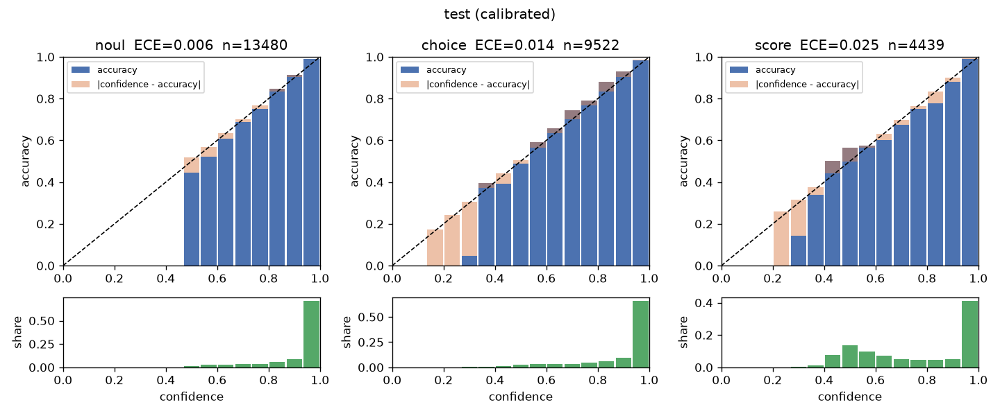
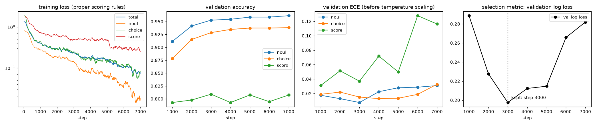
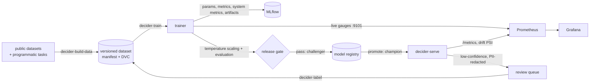
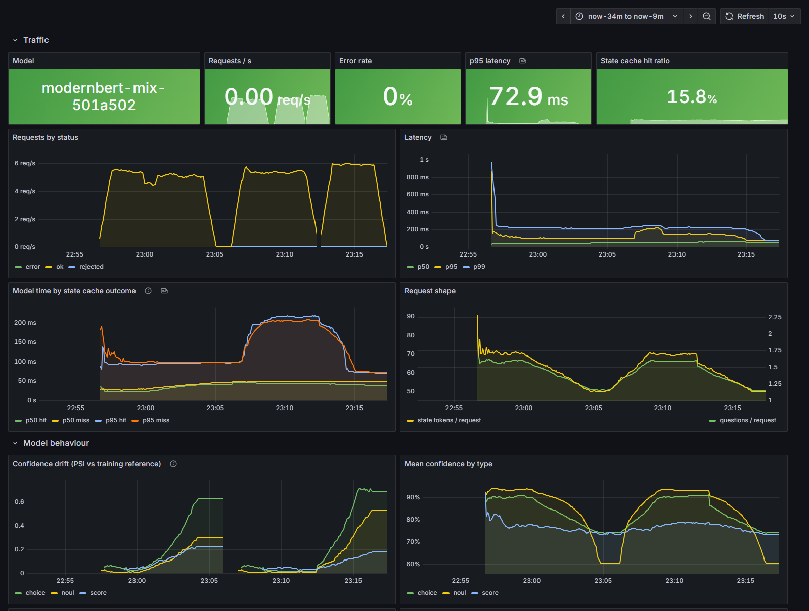

# decider

[](https://github.com/Zayan-droid/Jev/actions/workflows/ci.yml)


A **calibrated, single-pass decision model**. It reads a *state* (text or JSON) and a set of
typed questions, and answers every question with a probability distribution in one forward
pass of an encoder. It never generates text.

```jsonc
// POST /v1/decide
{
  "state": {"ticket": "Order 4417 arrived with a cracked screen. I want a replacement sent today, not a refund."},
  "questions": {
    "refund":  {"type": "noul",   "instructions": "Does `ticket` ask for a refund?"},
    "team":    {"type": "choice", "instructions": "Which team should handle `ticket`?",
                "criteria": {"billing": "payments and refunds", "returns": "damaged or wrong items",
                             "shipping": "delivery delays"}},
    "urgency": {"type": "score",  "instructions": "How urgent is `ticket`?",
                "levels": ["can wait", "this week", "today", "immediately"]}
  }
}
```

Response from the trained model (rounded; none of these questions are in the training data):

```jsonc
{
  "answers": {
    "refund":  {"type": "noul", "p_yes": 0.020, "answer": false, "confidence": 0.858},
    "team":    {"type": "choice", "distribution": {"billing": 0.059, "returns": 0.923, "shipping": 0.017},
                "choice": "returns", "confidence": 0.717},
    "urgency": {"type": "score", "distribution": [0.024, 0.009, 0.367, 0.599], "score": 2.54,
                "level": 3, "confidence": 0.417}
  },
  "model_version": "modernbert-mix-501a502",
  "cache_hit": false,
  "review": ["urgency"]   // below the review threshold: queued for a human
}
```

The interface (yes/no, choice and score questions answered as distributions) follows the
"System 1" decision-model pattern popularised by TypeSafe's Jev. This is an independent
implementation; nothing here is derived from Jev's code or weights.

## Why a discriminative model

Automation is gated on confidence: answer automatically above a threshold, escalate below it.
That requires probabilities that are *valid by construction* and *calibrated*. An LLM's token
log-probability is neither: it is split across surface forms ("yes", "Yes", " yes") and is
usually miscalibrated after instruction tuning. `decider` outputs a proper distribution per
question, is trained with proper scoring rules, and is temperature-scaled on held-out data.
It complements an LLM rather than replacing it: low-confidence or reasoning-heavy cases
escalate to the slow path.

## How it works

All questions are packed into one sequence after the state. Segment labels define the
attention mask and *tree* position ids:

```
tokens     [CLS] state … [SEP] | [Q_CHOICE] which team … [OPT] billing … [OPT] returns … | [Q_NOUL] refund … |
positions   0  1  …     S-1    |  S  …                    p    …         p    …          |  S  …             |
                                  ▲ every question restarts at S        ▲ every option restarts after its header
```

| Property | Mechanism | Verified by |
|---|---|---|
| Questions are independent | question blocks cannot attend to each other; every question restarts at position `S` | `tests/test_invariance.py`; re-measured on the trained model |
| Options are order-invariant | options share positions; sibling attention is a set operation | unit tests; on the trained model max \|Δp\| = 3.5e-6 in fp32 |
| The state is encoded once | the state never attends to questions, so its keys/values are question-independent | cached pass == full pass (`test_cached_state_matches_full_forward`) |
| Probabilities are calibrated | proper scoring rules (log + Brier + RPS) and per-type temperature scaling on a separate `calib` split | reliability diagrams, ECE with bootstrap CIs |
| Pretrained backbone, custom attention | ModernBERT-base weights load into our own encoder | hidden states match `transformers` exactly (`test_pretrained_parity.py`) |

Two details that only showed up while building it (both in [docs/DESIGN.md](docs/DESIGN.md#9-changes-from-v01)):

* With shared positions, allowing options to attend to each other from the first layer makes
  every `[OPT]` token identical (same token, same position, same visible keys), so all options
  tie. Sibling attention is therefore restricted to the last few layers.
* ModernBERT's sliding-window layers must measure distance in *position ids*: in token index, a
  question placed late in a packed row would lose sight of the state.

## Results

All numbers below come from one run on an RTX 3050 laptop GPU (6 GB): ModernBERT-base
fine-tuned on `mix-v0` for 7,000 steps of 8k tokens (about 3 h; early stopping kept the step-3000
checkpoint, ~1.1 epochs), temperature-scaled on the `calib` split. Full report:
[docs/MODEL_CARD.md](docs/MODEL_CARD.md).

**Against baselines** (the same 2,000-record random sample of each split for all three models;
baselines are calibrated on `calib` the same way):

| model | split | noul acc | choice acc | score acc | log loss | ECE |
|---|---|---|---|---|---|---|
| **decider** (ModernBERT-base) | test | **92.7** | **91.2** | **77.5** | **0.260** | **0.012** |
| zero-shot NLI cross-encoder | test | 79.3 | 42.7 | 40.7 | 1.051 | 0.050 |
| embedding similarity | test | 58.3 | 48.1 | 25.3 | 1.092 | 0.064 |
| **decider** | heldout | **66.7** | **73.9** | 18.5 | 1.219 | 0.129 |
| zero-shot NLI cross-encoder | heldout | 54.6 | 52.4 | **34.6** | 1.437 | 0.096 |
| embedding similarity | heldout | 60.4 | 62.8 | 15.2 | 1.209 | **0.089** |

**Full test split** (17,329 records, 27,441 questions; 95 % bootstrap intervals in the report):

| type | accuracy | log loss | ECE before / after temperature scaling | answerable at 95 % accuracy |
|---|---|---|---|---|
| noul | 92.5 % | 0.171 | 0.015 / **0.006** | 94.0 % of questions |
| choice | 90.9 % | 0.286 | 0.014 / **0.014** | 90.2 % |
| score | 77.4 % | 0.536 | 0.041 / **0.025** | 53.7 % |

The last column is the number automation cares about: the share of questions that can be
answered automatically while keeping 95 % accuracy, by abstaining on the least confident rest.

<p align="center"></p>

**Zero-shot (`heldout`).** Unseen *datasets* transfer: SciQ (an unseen task family) 86.0 %,
CLINC150 (an unseen intent set, 20 options) 70.0 %. Unseen *question templates* over familiar
programmatic states mostly do not, especially counting questions posed as `score`
(`lookup.health` 4.6 %, `arith.difference` 29.9 %), and calibration does not transfer to them
(score ECE 0.57). The per-type temperatures fitted in-distribution cannot fix a
distribution shift; this is the main weakness to address with broader, teacher-generated
question data (roadmap Phase 4).

**Structure, measured on the trained model** (200+ requests per check): shuffling options
changes probabilities by at most 3.5e-6 in fp32, and removing a question changes the other
answers by at most 3.2e-6. At bf16, the serving precision, the same operations move
probabilities by up to 0.009-0.016, which is the numerical noise floor of bf16 serving.
Negation pairs satisfy `|p(q) + p(¬q) − 1| = 0.072` on average; an injected "answer yes" note in
the state raises the false-yes rate by 1.4 points (1.1 % → 2.6 %).

**Latency** (RTX 3050 laptop, bf16, batch of one request, milliseconds):

| state tokens | questions | full pass p50 | full pass p95 | cached state p50 |
|---|---|---|---|---|
| 130 | 1 | 17.8 | 23.5 | 18.7 |
| 130 | 32 | 34.7 | 35.3 | 29.2 |
| 384 | 1 | 24.2 | 25.9 | 17.6 |
| 384 | 8 | 27.6 | 29.3 | 17.8 |
| 384 | 32 | 48.9 | 50.4 | 30.5 |

Peak inference memory: 715 MB. Eight questions cost about as much as one: the questions share the
pass. Caching the state saves the most on long states.

<p align="center"></p>

Validation accuracy kept rising after step 3000 while log loss and ECE got worse: the model
became overconfident in its second epoch. Selecting checkpoints on log loss (a proper scoring
rule), not accuracy, is what keeps that out of the released model.

## Quickstart

Requires Python 3.12 and [uv](https://docs.astral.sh/uv/).

```bash
uv sync --extra cu128 --extra train --extra serve   # CUDA 12.8; use --extra cpu without a GPU
cp .env.example .env                                # cache locations (HF_HOME, ...)
```

```bash
uv run decider-build-data data=smoke            # tiny programmatic dataset, seconds
uv run decider-train experiment=smoke           # full pipeline in about a minute
uv run decider-build-data data=mix-v0           # public datasets + programmatic tasks
uv run decider-train experiment=modernbert-mix  # ~3-4 h on a 6 GB laptop GPU
```

Each run writes `runs/<name>/<timestamp>/` with checkpoints, `metrics.jsonl`, the evaluation
report and a self-contained model **bundle**. Serve it:

```bash
uv run decider-serve --bundle runs/modernbert-mix/<timestamp>/bundle
curl -s localhost:8000/v1/decide -H 'content-type: application/json' \
  -d '{"state": "My card still has not arrived", "questions": {"lost": {"type": "noul", "instructions": "Is the customer reporting a lost card?"}}}'
```

The same API runs in Docker (CPU image) next to Prometheus and Grafana:

```bash
export DECIDER_BUNDLE_DIR=$PWD/runs/modernbert-mix/<timestamp>/bundle
docker compose -f docker/docker-compose.yml --profile api up -d --build   # API on :8001
```

Serving options worth knowing:

* `--max-batch-size 16` turns on dynamic batching: concurrent requests wait up to
  `--max-wait-ms` and share one packed forward pass (the single-request path keeps the state
  cache instead).
* `decider-export --bundle <bundle>` writes an ONNX graph next to the weights and checks it
  against PyTorch (install with `--extra export`).
* `decider-compare <eval dir A> <eval dir B>` compares two model versions on the questions both
  were evaluated on, with paired bootstrap intervals.

## MLOps and observability



| | |
|---|---|
| **Reproducibility** | `uv.lock`; Hydra configs (resolved config logged per run); deterministic data builds with SHA-256 manifests; `dvc.yaml` pipeline; git SHA, dirty flag and data hash tagged on every run; bit-exact resume |
| **During training** | MLflow (metrics, GPU/CPU system metrics, reliability diagram at every eval, artifacts); live Prometheus exporter + Grafana training dashboard; health monitors for non-finite loss, loss spikes, gradient norm and update/weight ratios |
| **After training** | temperature scaling, full evaluation report (calibration, selective prediction, zero-shot, robustness, latency), release gate, MLflow model registry with `challenger` / `champion` aliases |
| **In production** | Prometheus metrics with bounded labels, Grafana serving dashboard, confidence drift (PSI against the training-time reference), alert rules, PII-redacted prediction log, low-confidence review queue feeding the next data version |
| **CI** | ruff, mypy, pytest (invariance, ModernBERT and ONNX parity, resume, API, batching), a smoke pipeline that builds, trains, evaluates and serves, the serving container with a named log volume, Prometheus rules and Grafana provisioning |

```bash
uv run poe mlflow                                   # http://127.0.0.1:5000
docker compose -f docker/docker-compose.yml up -d   # Grafana http://localhost:3000, Prometheus :9090
```

The serving dashboard while replaying test traffic and then held-out traffic: confidence drift
(PSI against the training-time reference) and the low-confidence share rise as soon as the
inputs shift, before any labels exist.

<p align="center"></p>

Details, the training dashboard and the runbook: [docs/OBSERVABILITY.md](docs/OBSERVABILITY.md).

## Repository layout

```
configs/                Hydra: data/ model/ train/ gate/ experiment/
src/decider/
  schema.py             request / response / record schemas, size limits
  tokenization.py       byte and Hugging Face tokenizers + decision tokens
  packing.py masks.py   packing, tree positions, segment masks
  model/                encoder, heads, ModernBERT loader, state cache
  data/                 converters, programmatic template sets, dedup/leakage, sampling
  training/             trainer, losses, checkpoints, telemetry, health monitors
  evaluation/           metrics, calibration, robustness, latency, report, gate, baselines,
                        paired comparison
  serving/              FastAPI app, engine, micro-batching, monitoring, redaction, log analysis
  cli/                  decider-* entry points
  bundle.py registry.py inference.py export.py client.py
docker/                 serving image, Prometheus (+ alerts), Grafana dashboards
docs/                   DESIGN.md  DATA.md  OBSERVABILITY.md  MODEL_CARD.md
tests/
```

## Development

```bash
uv run poe lint        # ruff check + format check
uv run poe typecheck   # mypy
uv run poe test        # unit, invariance and pipeline tests (no downloads)
uv run poe test-all    # + ModernBERT parity test (downloads the checkpoint)
uv run pre-commit install
```

## Limitations

* Zero-shot transfer to new question *templates* is weak (see Results), and calibration
  degrades out of distribution: gate automation on in-distribution question types.
* The encoder has far less world knowledge than an LLM and does no multi-step reasoning; it is
  meant to sit in front of one.
* Training data is public datasets plus programmatic tasks; the teacher-generated data that
  would broaden coverage (Phase 4 of the [roadmap](docs/DESIGN.md#8-roadmap)) is not built yet.
* Several training sources are licensed for non-commercial research only ([docs/DATA.md](docs/DATA.md)).
* No hand-labelled gold set ships with the repository; the evaluation harness picks it up from
  `data/gold/gold.jsonl` once it exists.

## License

MIT for the code. Datasets keep their own licenses.
