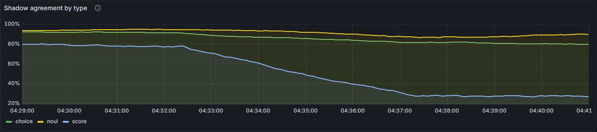

# Experiment log

One entry per experiment: what it was for, how it was run, what came out, what it changed.
Hardware throughout: one RTX 3050 Laptop GPU (6 GB), bf16. Run directories are local
(`runs/`); metrics, configs and reports are in the MLflow store.

## E1. Model v0.1: ModernBERT-base on `mix-v0`

**Question.** Does the packed design work with a pretrained encoder at all, and how calibrated
is it out of the box?

**Setup.** `experiment=modernbert-mix` at commit `501a502`; 8k-token batches, encoder LR 5e-5,
head LR 1e-3, 500 warmup steps, evaluation every 1k steps, early stopping on validation log loss.

**Result.** Validation log loss was best at step 3,000 (~1.1 epochs) and rose afterwards while
accuracy kept creeping up: the model became overconfident (validation ECE 0.012 → 0.044).
Early stopping ended the run at step 7,000 and the step-3,000 weights were released. Test:
noul 92.5 %, choice 90.9 %, score 77.4 %; ECE 0.006 / 0.014 / 0.025 after temperature
scaling (T ≈ 1.2-1.3). Held out: SciQ 86 %, CLINC150 70 %, but held-out counting templates
failed (`lookup.health` 4.6 %, `arith.difference` 29.9 %), confidently (score ECE 0.57).

**Decisions.** Select checkpoints on log loss, never accuracy. Held-out template failure
became the main target (E3, E4). Details: [MODEL_CARD.md](MODEL_CARD.md).

## E2. Toy model: byte tokenizer vs BPE

**Question.** The from-scratch `tiny` model (5M encoder parameters) learned the programmatic
tasks very slowly with the byte tokenizer. Is the tokenizer the bottleneck?

**Setup.** `experiment=toy` on `toy-v1`, 16k-token batches, LR 1e-3, identical except
`model.tokenizer`.

| tokenizer | val accuracy, step 1,000 | step 3,000 | test accuracy, step 6,000 | test ECE |
|---|---|---|---|---|
| bytes | 52.8 % | 57.9 % | (stopped) | |
| ModernBERT BPE | 69.5 % | 82.8 % | 91.0 % | 0.005 |

**Result.** BPE is decisively better. With bytes, every word has to be assembled from
characters before a question can be matched against the state, and the same token budget holds
fewer examples per batch. The small model still generalises poorly to held-out templates
(30.3 % accuracy, ECE 0.42), far below the pretrained model.

**Decision.** The toy experiment uses the BPE tokenizer. The byte tokenizer stays for the CI
smoke run, where it keeps the pipeline download-free.

## E3. Template diversity: `mix-v1` (model v0.2)

**Question.** Is the held-out template failure a data problem? v1 training data had two kinds
of `score` question, always worded the same way, so a model could learn level *positions*
instead of reading level descriptions.

**Hypothesis.** Adding counting, range and comparison questions to every training family,
with randomised level wording (template set v2), improves accuracy and calibration on the
*unchanged* held-out templates without hurting the public datasets.

**Setup.** `experiment=modernbert-mix-v1`: the E1 recipe on `mix-v1`, which differs from
`mix-v0` only in the synthetic template set (same sources, sizes and seed). Both models are
compared on the questions both datasets share (14,335 test records with 19,749 questions;
5,986 held-out records with 7,004 questions) with a record-level paired bootstrap
(`decider-compare`). Validation log loss was best at step 5,000 (v0.1: 3,000).

**Result.** Accuracy, v0.1 → v0.2, on the shared questions (`*`: the 95 % interval of the paired
difference excludes zero):

| split | group | n | v0.1 | v0.2 | difference | 95 % CI |
|---|---|---|---|---|---|---|
| test | all | 19,749 | 86.00 | 87.10 | +1.10 * | [+0.71, +1.52] |
| test | noul / choice / score | | | | +0.88 * / +1.19 * / +1.53 * | |
| test | intent routing (Banking77) | 3,056 | 88.02 | 91.16 | +3.14 * | [+2.09, +4.12] |
| heldout | all | 7,004 | 60.32 | 59.01 | −1.31 * | [−2.23, −0.40] |
| heldout | score | 1,486 | 17.29 | 23.55 | +6.26 * | [+3.43, +9.09] |
| heldout | choice | 4,307 | 73.69 | 69.28 | −4.41 * | [−5.36, −3.46] |
| heldout | lookup (counting templates) | 740 | 4.46 | 23.78 | +19.32 * | [+15.95, +22.84] |
| heldout | arithmetic | 746 | 30.03 | 23.32 | −6.70 * | [−10.99, −2.41] |
| heldout | intent routing (CLINC150) | 2,000 | 70.00 | 65.90 | −4.10 * | [−5.40, −2.85] |
| heldout | inventory / dates | 750 / 1,768 | | | −4.00 * / −3.45 * | |
| heldout | science QA (SciQ) | 1,000 | 86.00 | 84.80 | −1.20 | [−2.90, +0.50] |

Calibration on held-out `score` questions improved (ECE 0.57 → 0.47) but stays far from
usable. In distribution, calibration stays good but moves (test ECE noul 0.006 → 0.014,
choice 0.014 → 0.014, score 0.025 → 0.013).

The hypothesis holds only in part. The targeted failure moved: counting `lookup` questions
went from 4.5 % to 23.8 %, and held-out `score` questions gained 6 points. Everything else
held out got worse by 3-7 points, including CLINC150 and inventory questions that the change
did not touch, so the overall held-out difference is negative and significant.

**Follow-up: data or training length?** v0.2 was selected at step 5,000 and v0.1 at step
3,000, so the comparison mixes two changes. `experiment=modernbert-mix-v1-s3000` repeats the
v0.2 run and stops it at step 3,000 of the same 9,000-step schedule (`train.stop_at_step`; same
seed and learning rates; validation log loss within 0.007 of the original run at each
evaluation, the gap GPU non-determinism leaves; step 3,000 again the best). Held-out accuracy on the shared questions:

| family | v0.1 (mix-v0, step 3k) | v0.2 data, step 3k | v0.2 (step 5k) | data effect | longer fit |
|---|---|---|---|---|---|
| all | 60.32 | 57.64 | 59.01 | −2.68 * | +1.37 * |
| arithmetic | 30.03 | 15.15 | 23.32 | −14.88 * | +8.18 * |
| inventory | 96.00 | 84.53 | 92.00 | −11.47 * | +7.47 * |
| lookup | 4.46 | 10.81 | 23.78 | +6.35 * | +12.97 * |
| intent routing (CLINC150) | 70.00 | 68.35 | 65.90 | −1.65 * | −2.45 * |
| dates | 55.88 | 54.69 | 52.43 | −1.19 | −2.26 * |
| science QA (SciQ) | 86.00 | 87.60 | 84.80 | +1.60 | −2.80 * |

In distribution, the step-3,000 run matches v0.1 (86.11 vs 86.00 %, +0.11 [−0.30, +0.49]): all of
v0.2's in-distribution gain comes from the longer fit.

The longer-fit explanation is wrong as the main cause. At equal steps the new templates cost
2.7 held-out points, mostly on held-out *programmatic* templates (arithmetic −15, inventory
−11) and helped only the counting family they targeted. What the data did change is when
overfitting starts: validation log loss bottomed out at step 5,000 instead of 3,000, and
those extra 2,000 steps bought the in-distribution gain and back part of the held-out loss on
programmatic templates, while costing 2-3 points on the public held-out datasets. One reading,
not tested: v0.1 transferred to the held-out programmatic templates partly through fixed
level wording they share with training, a shortcut the randomised wording removed.

**Decisions.** Template set v2 is not a transfer improvement and should not be sold as one;
its measurable benefit is a later overfitting point. Neither released model dominates, so the
choice is a product decision: v0.2 is better on in-distribution questions (where automation
would be gated) and v0.1 transfers better. v0.2 passed the release gate and is registered as
`challenger`; `champion` stays unassigned until an owner promotes one. The README and model
card keep describing v0.1. Programmatic template tweaks have reached diminishing returns for
transfer; broader, independently written questions (roadmap Phase 4) are the next lever.

## E4. Question familiarity

**Question.** Can the model tell when a question is unlike anything it was calibrated on?

**Setup.** Mahalanobis distance of each question's readout features to a per-type Gaussian
(shrunk covariance) fitted on 70 % of the calibration records; the threshold is the 95th
percentile on the other 30 %, so about 5 % of in-distribution questions are flagged by design
(`decider-familiarity`). Measured on up to 6,000 records per split: the flagged share, AUROC for
separating test from held-out questions (*shift*), and AUROC for ranking wrong answers above
right ones (*errors*) against the obvious baseline, low confidence.

**Result.**

| model | type | flagged, test | flagged, heldout | AUROC shift | AUROC errors on heldout: familiarity / confidence |
|---|---|---|---|---|---|
| v0.1 | noul | 3.5 % | 4.5 % | 0.868 | 0.535 / 0.436 |
| v0.1 | choice | 4.7 % | 58.1 % | 0.959 | 0.464 / 0.813 |
| v0.1 | score | 5.4 % | 100.0 % | 1.000 | 0.713 / 0.555 |
| v0.2 | noul | 6.5 % | 47.6 % | 0.914 | 0.371 / 0.488 |
| v0.2 | choice | 4.5 % | 53.6 % | 0.932 | 0.441 / 0.794 |
| v0.2 | score | 5.4 % | 81.7 % | 0.977 | 0.434 / 0.465 |

* The score detects *shift* well (AUROC 0.87-1.00): held-out `score` questions, where the
  model is right 17-24 % of the time, are almost all flagged.
* It does not detect *errors*: within a split, flagged questions are about as accurate as the
  rest, and its error AUROC (0.37-0.71) is below that of low confidence in distribution (0.83-0.92
  on test). On held-out `noul` and `score` questions, confidence is no better than chance
  (0.44-0.56): the model is confidently wrong there, and nothing computed from one answer
  catches it.
* Two bugs found on the way. Thresholding on the points the Gaussian was fitted on flagged
  8-14 % of test questions instead of 5 % (in 768 dimensions, in-sample distances are biased
  low). Splitting calib into fit and threshold parts by the dataset's own id hash put every
  public-source record on one side, because dataset splits are assigned by that hash; the
  split hash is now salted, and a test pins both.
* Serving reproduces the offline numbers: replaying test traffic through the v0.2 server
  flagged 4.3-5.3 % of answers per type, held-out traffic 42 / 50 / 78 % (noul / choice / score).

**Decisions.** The detector ships in every bundle (training fits it next to the temperatures)
as a *population* signal: flagged questions are returned in the response, counted in
`decider_unfamiliar_total`, shown on the serving dashboard, alerted on above 20 %, and queued for
labelling with the low-confidence ones. It is not a per-answer correctness score, and
confidence remains what automation is gated on.

## E5. Value of pretraining

**Question.** How much of v0.1's quality comes from ModernBERT's pretraining rather than from
the architecture and the data?

**Setup.** `experiment=small-mix`: a 34.0M-parameter encoder (8 layers, width 384, ModernBERT's
attention layout and tokenizer) trained from scratch on `mix-v0`, with the E1 recipe adapted
to a from-scratch model (16k-token batches, LR 6e-4, early stopping on validation log loss).
Validation log loss was best at step 5,000 (3.7 epochs) and early stopping ended the run at
9,000; 68 minutes in all at ~38k tokens/s, against ~5.3k for ModernBERT-base. Compared with
v0.1 on the shared questions (test: public datasets only) and on the full `mix-v0` reports.

**Result.** Accuracy, from scratch → ModernBERT-base:

| split | group | from scratch | ModernBERT | difference (95 % CI) |
|---|---|---|---|---|
| test | all 19,749 shared questions | 71.32 | 86.00 | +14.68 (+14.02, +15.36) |
| test | entailment (MNLI) | 50.91 | 85.82 | +34.92 |
| test | reading QA (BoolQ) | 57.07 | 77.00 | +19.93 |
| test | topic (AG News) | 90.65 | 94.22 | +3.57 |
| test | programmatic families (full report) | 76-88 | 97-100 | |
| heldout | all 7,004 shared questions | 25.40 | 60.32 | +34.92 (+33.46, +36.40) |
| heldout | CLINC150 intents (20 options) | 7.25 | 70.00 | +62.75 |
| heldout | SciQ (4 options) | 28.20 | 86.00 | +57.80 |
| heldout | counting templates (`lookup`) | 22.16 | 4.46 | −17.70 |

In-distribution ECE after temperature scaling: noul 0.044, choice 0.010, score 0.050, against
v0.1's 0.006 / 0.014 / 0.025. The small model answers a 130-token state in 10 ms (p50) whether
it carries 1 or 32 questions, 1.7-3.5x faster than ModernBERT-base, with 293 MB peak memory
instead of 715 MB.

* Pretraining is most of the model. It is worth 15 points in distribution, most where reading
  matters (entailment +35, reading QA +20) and least where keywords suffice (topic +4).
* Zero-shot transfer is almost entirely pretraining. From scratch, unseen option sets are at
  chance: 7 % on 20 CLINC150 intents (5 % chance), 28 % on 4 SciQ answers (25 %). The packed
  architecture alone does not make a model read option descriptions it was never trained on.
* The one reversal is informative. On held-out counting templates the from-scratch model is
  right 22 % of the time and ModernBERT 4.5 %, below the rate of guessing among even ten levels:
  the fine-tuned pretrained model has learned a systematic wrong answer, not merely failed to
  learn the right one. This fits E3's reading that fine-tuning picks up shortcuts from fixed
  template wording.

**Decisions.** The from-scratch model is not a release candidate; it stays as the reference
point that shows what the pretrained backbone buys. Model size is not where to cut cost:
dynamic batching and ONNX (E6) are.

## E6. Serving throughput: dynamic batching and ONNX

**Question.** What do dynamic batching (`--max-batch-size`) and the ONNX export buy on this
hardware?

**Setup.** v0.2 bundle. Load test: `decider-loadtest`, 500 requests sampled from `mix-v1` test,
server (bf16, RTX 3050 laptop) and client on the same machine, end-to-end HTTP latency. ONNX:
`decider-export`, fp32 on an i5-13420H CPU (8 cores), onnxruntime 1.31 vs PyTorch 2.11, p50 of
10 runs per shape.

**Result.** Dynamic batching (up to 16 requests, 5 ms window) vs one request per pass:

| concurrency | requests/s | p50 ms | p95 ms | batched: requests/s | p50 ms | p95 ms |
|---|---|---|---|---|---|---|
| 1 | 19.9 | 48.0 | 75.1 | 16.0 | 60.1 | 92.8 |
| 4 | 25.6 | 152.1 | 207.9 | 32.7 | 114.6 | 210.1 |
| 16 | 25.1 | 623.7 | 753.2 | 42.6 | 379.4 | 468.4 |

ONNX export: max |logit difference| to PyTorch 1.0e-5; CPU latency p50:

| state tokens | questions | PyTorch | onnxruntime |
|---|---|---|---|
| 32 | 1 | 108.8 ms | 39.2 ms |
| 128 | 4 | 365.4 ms | 159.0 ms |
| 384 | 8 | 731.5 ms | 638.6 ms |

**Decisions.** Without batching the GPU saturates at about 25 requests/s and latency grows
linearly with concurrency; batching raises throughput 1.7x at concurrency 16 and cuts p50 by
40 %, but costs 12 ms at concurrency 1 (the wait window, and no state cache). Batching stays
off by default and is the setting for concurrent traffic. For CPU-only serving, onnxruntime is
2-3x faster on short requests and about equal on long ones.

## E7. Cross-option attention

**Question.** The last four encoder layers let the options of a question attend to each other
(`cross_option_layers: 4`). What is that worth, compared with reading each option only against
the state and the question?

**Setup.** `experiment=modernbert-mix-xopt0`: v0.1's recipe and data with `cross_option_layers:
0`. The mask is the only change: the parameter count and compute are identical. The run's
validation log loss was best at step 5,000 (0.209; v0.1: 0.198 at step 3,000), so the released
checkpoints differ in training length as well, the confound found in E3. A rerun stopped at step
3,000 of the same schedule (`experiment=modernbert-mix-xopt0-s3000`; validation log loss within
0.02 of the first run at step 1,000 and within 0.002 at steps 2,000 and 3,000) gives the
step-matched comparison. Paired on the shared questions (`decider-compare`, record-level
bootstrap).

**Result.** Accuracy, v0.1 → no cross-option layers, both at step 3,000:

| split | group | v0.1 | no cross-option | difference (95 % CI) |
|---|---|---|---|---|
| test | all 19,749 questions | 86.00 | 85.99 | −0.01 (−0.33, +0.32) |
| heldout | all 7,004 questions | 60.32 | 59.58 | −0.74 (−1.62, +0.10) |
| heldout | choice | 73.69 | 71.37 | −2.32 (−3.18, −1.46) |
| heldout | score | 17.29 | 22.54 | +5.25 (+2.76, +7.67) |
| heldout | noul | 65.57 | 63.09 | −2.48 (−5.07, +0.16) |
| heldout | CLINC150 intents | 70.00 | 67.65 | −2.35 * |
| heldout | inventory | 96.00 | 90.80 | −5.20 * |
| heldout | arithmetic | 30.03 | 23.73 | −6.30 * |
| heldout | counting templates (`lookup`) | 4.46 | 21.35 | +16.89 * |

The same run continued to its selected step 5,000: +1.15 (+0.74, +1.56) in distribution and
−1.73 (−2.75, −0.74) held out against its own step 3,000, with held-out noul −8.4.

* In distribution, letting options see each other is worth nothing measurable.
* Held out, it is worth 2.3 points on `choice` questions: when the option set is new (20
  CLINC150 intents, unseen inventory questions), comparing options helps.
* It costs 5 points on `score`, almost all on the held-out counting templates, where v0.1 is
  below chance (E5). Score levels are options too, and the shortcut v0.1 learned there appears to
  rely on levels reading each other. One reading, not tested: attention between the level
  wordings lets the model latch onto the fixed wording, which E3 already pointed at.
* noul questions have no options, so the mask cannot affect them directly; their 2.5-point
  held-out difference is the order of run-to-run variation on held-out families. Family
  differences of 2-3 points should be read with that in mind; the 5-17 point ones stand.
* Training length again explains the in-distribution gain of the longer run, and again costs
  transfer, now with the data held fixed. Two experiments (E3, E7) agree that selecting
  checkpoints on in-distribution validation loss trades held-out accuracy for in-distribution
  accuracy.

**Decisions.** Keep four cross-option layers: they cost no parameters or compute and are the
better choice for unseen option sets, the case that matters most for zero-shot use. The score
shortcut is a data problem to fix with independently written questions (roadmap Phase 4), not
with the mask. Checkpoint selection should see shifted questions: the next training change is a
validation split built from templates disjoint from training and `heldout`.

## E8. Shadow deployment

**Question.** Can a candidate be evaluated on live traffic without affecting it, and does the
live comparison agree with the offline one (E3: v0.2 +1.1 points in distribution, −1.3 held
out)?

**Setup.** `decider-serve --bundle <v0.1> --shadow-bundle <v0.2>` on the RTX 3050, both bf16.
Traffic replayed from the shared question set with `decider-loadtest --tag-ids`, so the shadow
log can be joined with the labels (`decider-shadow --labels`). Throughput: 600 test requests,
closed loop (each client sends its next request when the last returns). Live comparison:
3,600 test then 3,600 held-out requests at a steady 8 requests/s (`--rate 8`, open loop, about a
quarter of capacity).

**Result: cost.** The first implementation ran the shadow whenever a request was queued. The
response never waited for it, but the shadow shares the hardware:

| shadow | 1 client: req/s | p50 ms | 8 clients: req/s | p50 ms | requests shadowed |
|---|---|---|---|---|---|
| none | 22.4 | 41.7 | 29.8 | 265.7 | |
| GPU, whenever queued | 16.3 | 54.4 | 17.2 | 459.5 | 100 % |
| GPU, live idle only (default) | 16.3 | 54.1 | **29.9** | 267.5 | 71 % |
| GPU, idle only, 25 % sampled | 20.0 | 46.4 | 30.1 | 265.5 | 25 % |
| CPU, idle only | 12.7 | 78.3 | 28.8 | 275.3 | 13 % |

Run whenever queued, the shadow took 42 % of peak throughput on the GPU, and 61 % on the CPU,
where it competes with the server's own threads (first measurement: 11.7 requests/s). The
default now runs it only while no live request is in flight. Under load that protects
throughput completely, and the shadow covers less traffic instead: with two clients sending
back to back it covered 7 % of 14,000 requests, and `DeciderShadowFallingBehind` would fire. A
single back-to-back client is the worst case for latency: the server is idle between every
two requests, so each request finds a shadow pass running and waits for it (+12 ms p50).
Sampling scales that cost down. At 8 requests/s the shadow answered all 7,200 requests and
dropped none. Live latency on that test traffic was p50 44.2 ms / p95 75.5 ms, against
44.6 / 97.2 ms for the same schedule without a shadow: no measurable cost (the p95 gap, in the
shadow's favour, is run-to-run noise).

**Result: the comparison.** Live v0.1 vs shadow v0.2 on the same requests at 8 requests/s:

| traffic | labelled questions | v0.1 | v0.2 | difference (95 % CI) | offline (E3) |
|---|---|---|---|---|---|
| test | 4,371 | 86.57 | 88.10 | +1.53 (+0.64, +2.43) | +1.10 |
| heldout | 3,135 | 60.73 | 59.43 | −1.31 (−2.63, +0.06) | −1.31 |

Where the answers differed on test traffic, v0.2 was the one that was right 217 times and v0.1
150 times. Agreement needs no labels and moved with the traffic: on score questions it fell
from about 78 % to 27 % within five minutes of held-out traffic starting, while the
confidence-based signals moved too (E4):

An earlier run of 3,000 requests with both models on the CPU gave the same directions (+0.9 test,
−2.5 held out) but too few test questions (1,970) for the in-distribution gain to be
significant: with these effect sizes, a shadow needs a few thousand labelled questions per
traffic type before it can decide a promotion.

**Decisions.** The shadow runs in the server's idle time by default; `--shadow-always` is for a
shadow on hardware the live model does not use, and `--shadow-fraction` bounds the low-load
latency cost. The live comparison reproduces the offline one, so it can stand in for it on
production traffic once that traffic is labelled (`decider-label`). For v0.1 vs v0.2 it adds no
new information: the trade-off between in-distribution and held-out accuracy is the same, and
promotion stays an owner's decision.
