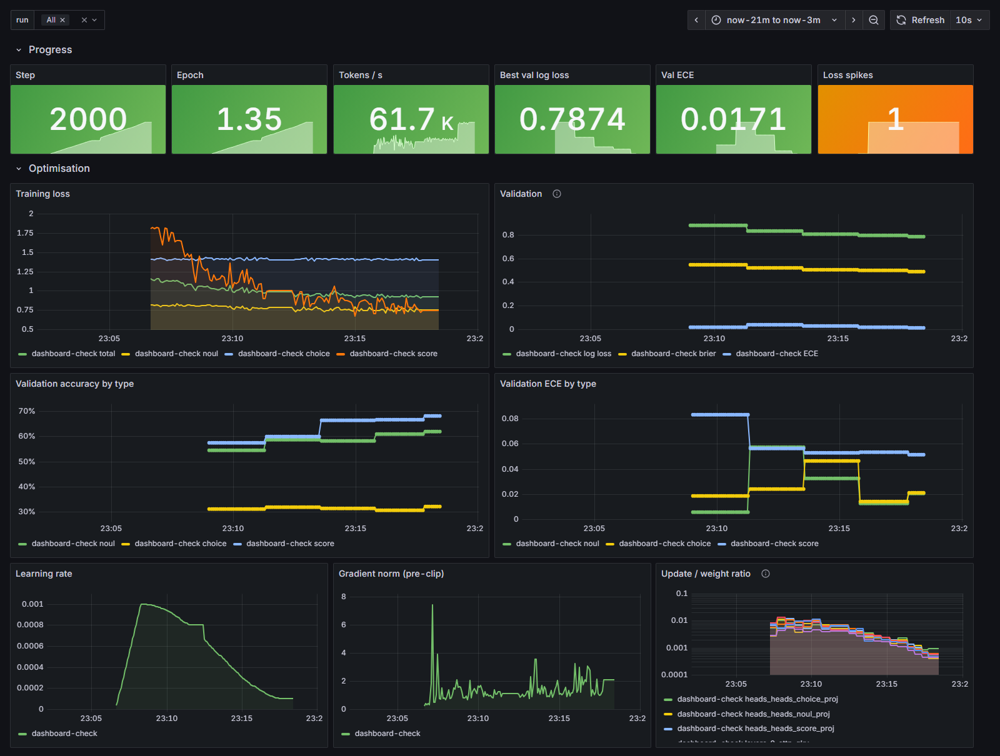

# Observability

What is measured, where it goes, and what to do when something looks wrong. Three phases:
training, evaluation/release, and production.

```
decider-train ──► metrics.jsonl (run dir)          decider-serve ──► /metrics ──► Prometheus ──► Grafana
      │       ──► MLflow (params, metrics,                │                          │
      │            system metrics, artifacts)             ├──► logs/predictions.jsonl  └──► alerts.yml
      └───────► :9101/metrics ──► Prometheus ──► Grafana  └──► data/feedback/queue.jsonl ──► decider-label
```

## Starting the tools

```bash
uv run poe mlflow                                   # MLflow UI on http://127.0.0.1:5000
docker compose -f docker/docker-compose.yml up -d   # Prometheus :9090, Grafana :3000
```

Training writes straight to the SQLite store in `mlflow/`, so the MLflow UI can be started
before, during or after a run. Prometheus scrapes the trainer on `:9101` and the API on
`:8000` of the host; both dashboards are provisioned automatically and readable without
logging in (admin / admin to edit).

The API can also run in the stack, from the CPU image, on port 8001:

```bash
export DECIDER_BUNDLE_DIR=$PWD/runs/<name>/<timestamp>/bundle   # PowerShell: $env:DECIDER_BUNDLE_DIR = ...
docker compose -f docker/docker-compose.yml --profile api up -d --build
```

Its prediction log and review queue are kept on the `api-logs` volume.

## 1. During training

| Signal | Where | Why it matters |
|---|---|---|
| `train/loss` and per-type losses (`loss_noul`, `loss_choice`, `loss_score`, `rps`) | MLflow, Grafana, console | one question type can stall while the total improves |
| `val/log_loss`, `val/brier`, `val/ece`, per type and per family | MLflow, Grafana | model selection uses validation log loss (a proper scoring rule) |
| reliability diagram at every evaluation | MLflow artifacts `reliability/` | shows *where* calibration is off, not just how much |
| `train/lr`, `train/grad_norm` (before clipping) | MLflow, Grafana | grad norm pinned at the clip value means the LR is too high |
| `health/update_ratio/*` (‖ΔW‖/‖W‖ for embeddings, first/middle/last layer, heads) | MLflow, Grafana | ~1e-3 is healthy; ≫1e-2 diverging, ≪1e-5 frozen |
| `health/loss_spikes`, `health/loss_ema` | MLflow, Grafana | spikes are logged as warnings; a non-finite loss stops the run |
| `perf/tokens_per_s`, `perf/step_time_s`, `perf/data_time_frac`, `perf/packing_efficiency` | MLflow, Grafana | data time > 10 % means the input pipeline is the bottleneck |
| `gpu/*` (allocated, peak, reserved memory; utilisation, temperature, power) | MLflow (+ MLflow system metrics), Grafana | peak memory close to capacity predicts OOMs; laptop GPUs throttle on temperature |
| `progress/epoch` | MLflow, Grafana | how many passes over the training mix so far |

Every run also logs, once: the resolved config, the dataset manifest (data hash, counts,
licenses), a model summary (parameters per module, mixture weights), and tags for the git SHA,
dirty flag, data hash and hardware.

### Checkpoints and resuming

`runs/<name>/<timestamp>/checkpoints/` holds `last.pt`, the most recent `step_*.pt` and
`best.pt` (best validation log loss). Checkpoints include the data stream and RNG state;
Ctrl+C writes one before exiting. Resume by pointing at the same directory:

```bash
uv run decider-train experiment=modernbert-mix run_dir=runs/modernbert-mix/<timestamp>
```

The run continues as the same MLflow run, and the result is bit-identical to an uninterrupted
run (`tests/test_pipeline.py::test_resume_after_interruption_is_exact`).

## 2. After training: evaluation and release

At the end of every run the trainer restores the best checkpoint, fits one temperature per
question type on the `calib` split, and runs the evaluation harness on `test` and `heldout`
(and `gold` when present). Outputs, in the run directory and in MLflow under `eval/`:

* `report.json`: every metric, overall and per type / family / source, before and after
  temperature scaling, with 95 % bootstrap intervals;
* `report.md`: the same as tables;
* `figures/`: reliability diagrams (uncalibrated and calibrated) and risk-coverage curves;
* robustness: permutation gap, question-independence gap, negation consistency, prompt-injection
  effect;
* latency: full vs. cached pass across state sizes and question counts.

Then the release gate (`configs/gate/default.yaml`) runs. Registered versions carry every
check as an MLflow tag; versions that pass get the `challenger` alias. Promotion to `champion`
is a deliberate step:

```bash
uv run decider-register list
uv run decider-register promote --version 3
uv run decider-serve --model-uri models:/decider@champion
```

Re-evaluate any bundle on any dataset version (also used for baselines):

```bash
uv run decider-eval --bundle runs/<name>/<ts>/bundle --data data/processed/mix-v0
uv run decider-eval --baseline nli --data data/processed/mix-v0
```

Every evaluation also writes one row per question (`predictions_<split>.jsonl.gz`). Before
promoting a new version, compare it with the current one on the questions both were evaluated
on; the intervals come from a paired bootstrap over records, so a difference marked `*` is
unlikely to be noise:

```bash
uv run decider-compare runs/<old>/eval runs/<new>/eval --split heldout --by family
```

Before deploying, measure the server under concurrent load on the target hardware, with and
without dynamic batching:

```bash
uv run decider-serve --bundle <bundle> --max-batch-size 16 &
uv run decider-loadtest --data data/processed/mix-v1 --concurrency 1 4 16
```

## 3. In production

### Metrics (`GET /metrics/`)

| Metric | Type | Labels |
|---|---|---|
| `decider_requests_total` | counter | `status` = ok / rejected / error |
| `decider_request_latency_seconds` | histogram | |
| `decider_model_latency_seconds` | histogram | `cache` = hit / miss / batched |
| `decider_batch_size` | histogram | requests per forward pass (dynamic batching) |
| `decider_questions_per_request`, `decider_state_tokens` | histogram | |
| `decider_confidence` | histogram | `type` |
| `decider_low_confidence_total` | counter | `type` |
| `decider_noul_answers_total` | counter | `answer` |
| `decider_state_cache_total`, `decider_state_cache_bytes` | counter, gauge | `result` |
| `decider_confidence_psi` | gauge | `type` |
| `decider_model_info` | gauge | `version` |
| `decider_log_write_errors_total` | counter | `sink` = predictions / feedback |

Labels are bounded (question *type*, never question name or option), so cardinality does not
grow with traffic.

### Drift

Labels are not available at serving time, so the first signal is the model's own confidence.
The bundle stores the confidence histogram measured on the test split (`reference.json`); the
server compares a rolling window of live confidences against it with the population stability
index, per question type (`GET /v1/drift`, `decider_confidence_psi`). PSI < 0.1 is stable,
0.1-0.25 is drifting, > 0.25 should be investigated.

### Logs and the feedback loop

* `logs/predictions.jsonl`: request id, model version, a SHA-256 of the state, the redacted
  state (emails, card numbers, phone numbers and IPs replaced; `--no-state-logging` keeps only
  the hash), questions, answers, latency, cache hit.
* `data/feedback/queue.jsonl` (`--feedback-queue`): requests with at least one answer whose
  top-label probability, the calibrated chance of being right, is below `--low-confidence`
  (default 0.6). This is deliberately not the response's `confidence` field, which is an
  entropy-based score over the whole distribution.
* Writing either file never fails a request: errors are logged, counted in
  `decider_log_write_errors_total` and raise the `DeciderLogWritesFailing` alert.
* `uv run decider-label` walks the queue in the terminal and writes canonical records to
  `data/feedback/labeled.jsonl`, which `mix-v0` already lists under `local_sources`: the next
  `decider-build-data` folds the labels into the training data. `--split gold` writes to the
  hand-labelled evaluation set instead.

### Offline report

Prometheus shows the present; `decider-monitor` summarises the prediction log per day:
volume, latency percentiles, cache hit rate, noul yes-rate, and per question type the mean
confidence, low-confidence share and PSI against the bundle's reference.

```bash
uv run decider-monitor --log logs/predictions.jsonl --bundle runs/<name>/<ts>/bundle
```

### Dashboards

Training dashboard during a run (here a short run of the tiny model on `toy-v1`):



Serving dashboard while replaying test-split traffic and then held-out traffic: the
confidence-drift panel crosses the 0.25 PSI threshold and the low-confidence share rises as
soon as the inputs shift, without any labels.


### Alerts (`docker/prometheus/alerts.yml`)

| Alert | Condition | First things to check |
|---|---|---|
| `DeciderHighErrorRate` | > 1 % errors for 5 min | server logs; recent deploy; malformed clients |
| `DeciderLatencyP95High` | p95 > 250 ms for 10 min | state length histogram; cache hit ratio; device |
| `DeciderConfidenceDrift` | PSI > 0.25 for 15 min | state length and question mix; sample `predictions.jsonl` |
| `DeciderLowConfidenceSurge` | > 30 % of answers below threshold | new question types or domains; label the queue |
| `DeciderLogWritesFailing` | any failed write to the prediction log or review queue | disk space; volume permissions |
| `DeciderTrainingStalled` | trainer up, step unchanged for 10 min | data loader, GPU, deadlock |
| `DeciderLossSpikes` | > 3 spikes in 10 min | learning rate; a bad data source |
